# TRAZO · Checkout con tarjeta

> Tienda mobile-first de zapatillas con checkout de pago con tarjeta de crédito: catálogo con stock en vivo, pago en 5 pasos, recuperación tras refresh y entrega asignada al aprobarse el pago.
> **React + Redux** · **NestJS con arquitectura hexagonal + ROP** · **PostgreSQL** · **DigitalOcean App Platform** (activo) · **AWS CDK** (listo)

| | |
|---|---|
| 🌐 **App** | **[card-checkout-app-b8d5l.ondigitalocean.app](https://card-checkout-app-b8d5l.ondigitalocean.app)** · DigitalOcean App Platform ([Despliegue](#-despliegue)) |
| 📘 **Swagger (público)** | [card-checkout-app-b8d5l.ondigitalocean.app/api/v1/docs](https://card-checkout-app-b8d5l.ondigitalocean.app/api/v1/docs) · contrato versionado en [`docs/openapi.json`](docs/openapi.json) |
| 🧪 **Postman** | [`docs/postman/card-checkout.postman_collection.json`](docs/postman/card-checkout.postman_collection.json) |
| ✅ **Tests** | Backend **121** · Frontend **92** · Infra **7** — cobertura **> 99 %** de líneas ([detalle](#-tests-y-cobertura)) |

<p align="center">
  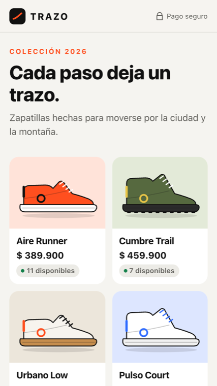
  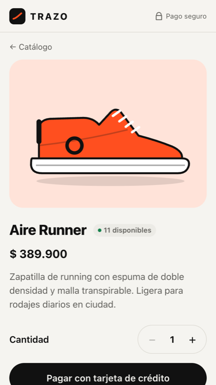
  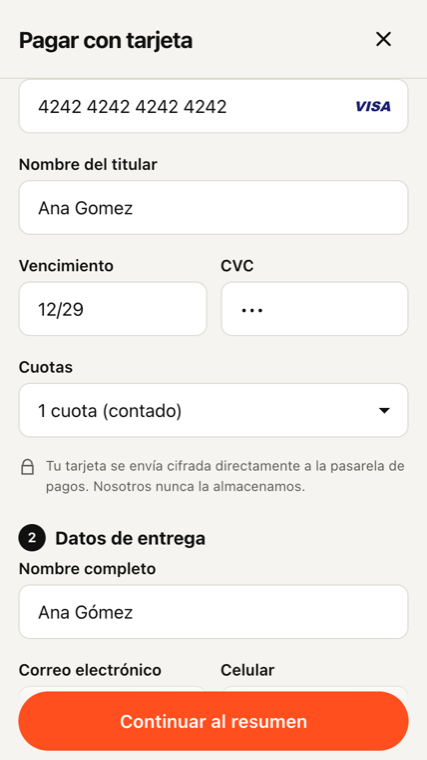
  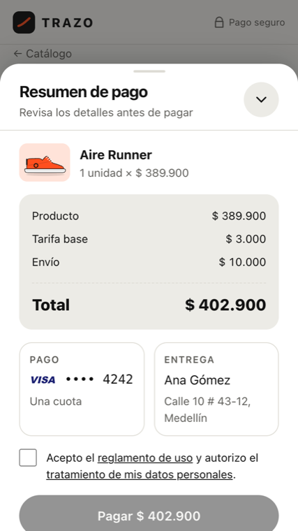
  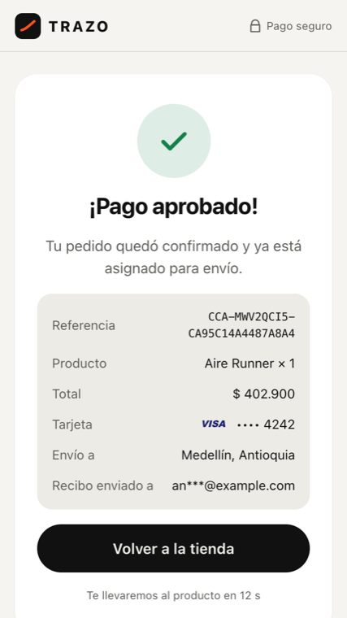
</p>
<p align="center"><sub>iPhone SE (375 × 667): 1. Catálogo → 2. Tarjeta/Entrega → 3. Resumen → 4. Estado final → 5. Producto con stock actualizado</sub></p>

---

## Contenido

1. [Lo que hace](#-lo-que-hace)
2. [Decisiones que marcan la diferencia](#-decisiones-que-marcan-la-diferencia)
3. [Arquitectura](#-arquitectura)
4. [Flujo de pago](#-flujo-de-pago)
5. [Modelo de datos](#-modelo-de-datos)
6. [API](#-api)
7. [Seguridad](#-seguridad)
8. [Resiliencia (refresh)](#-resiliencia-refresh)
9. [Frontend y UX](#-frontend-y-ux)
10. [Tests y cobertura](#-tests-y-cobertura)
11. [Ejecutar en local](#-ejecutar-en-local)
12. [Despliegue](#-despliegue)
13. [Uso de IA](#-uso-de-ia)

---

## 🛍 Lo que hace

| Paso | Pantalla | Qué ocurre |
|------|----------|------------|
| 1 | **Producto** | Catálogo y detalle con precio, descripción y **unidades disponibles** en vivo. |
| 2 | **Tarjeta + entrega** (modal) | Validación en tiempo real (Luhn, vencimiento, CVC), **detección de VISA / Mastercard** con logo, tarjeta 3D que gira al escribir el CVC, y datos de envío. La tarjeta se **tokeniza directamente con la pasarela**. |
| 3 | **Resumen** (backdrop de Material) | Producto + **tarifa base** + **envío** = total, método de pago (•••• 4242) y aceptación de términos. |
| 4 | **Estado final** | El backend crea la transacción en **PENDING**, cobra, consulta el resultado, **asigna la entrega** y **actualiza el stock**. |
| 5 | **Producto** | Regreso automático (o con un botón) al producto con el stock ya actualizado. |

**Tarjetas de prueba (sandbox):** `4242 4242 4242 4242` → aprobada · `4111 1111 1111 1111` → rechazada · cualquier CVC de 3 dígitos y una fecha futura.

---

## ✨ Decisiones que marcan la diferencia

- 🔐 **El número de tarjeta nunca toca el backend.** El navegador tokeniza la tarjeta con la llave pública y el servidor solo recibe `tok_…`. Tampoco llega a Redux: la tokenización ocurre fuera del store, para que no aparezca ni en el historial de acciones de DevTools. ([ADR 002](docs/adr/002-tokenizacion-en-el-navegador.md))
- 🧮 **El monto se calcula siempre en el servidor.** Si el cliente envía un campo `totalInCents`, la API responde 400. Además, si la pasarela confirma un monto o una referencia distinta, la transacción queda en `ERROR` y no se asigna el producto.
- 🔁 **Cero cobros dobles.** Una `Idempotency-Key` por intento de pago cubre el doble clic, los reintentos de red y el refresh a mitad del pago. ([ADR 004](docs/adr/004-idempotencia-polling-y-webhook.md))
- 📦 **Stock sin sobreventa.** La reserva se hace con un `UPDATE … WHERE stock >= q` atómico, dentro de una transacción SQL. Está probado con 10 compras concurrentes sobre 5 unidades: ganan exactamente 5. ([ADR 003](docs/adr/003-reserva-atomica-de-stock.md))
- 🚂 **ROP de verdad.** Un `Result`/`ResultAsync` propio, sin `try/catch` en los casos de uso, con los errores de negocio como parte del tipo de retorno. ([ADR 001](docs/adr/001-hexagonal-y-rop.md))
- 🧪 **Tests contra PostgreSQL real, sin Docker.** Usan `embedded-postgres`, así que `npm test` funciona en cualquier máquina y en CI.
- 🔎 **Verificado contra el sandbox real.** Al probar el flujo completo descubrimos que los *acceptance tokens* de la pasarela son de un solo uso, y por eso no se cachean.

---

## 🧱 Arquitectura

### Vista general

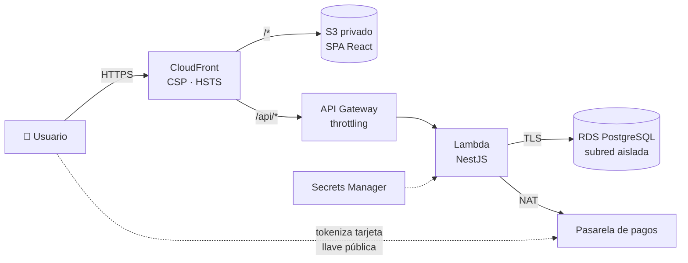

### Backend: hexagonal (puertos y adaptadores)

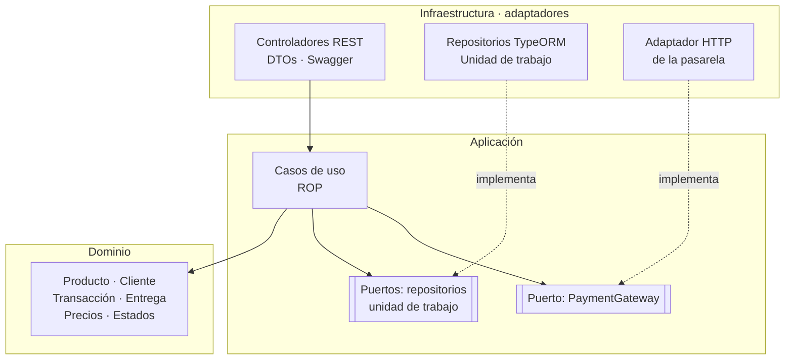

- **El dominio no depende de nada.** No importa Nest, TypeORM ni HTTP.
- **Los casos de uso son clases puras** que reciben sus puertos por constructor. Nest solo las conecta en [`checkout.module.ts`](backend/src/checkout.module.ts), el *composition root*.
- **Los controladores no tienen lógica.** Validan con DTOs, llaman al caso de uso y presentan la respuesta ([`controllers.ts`](backend/src/infrastructure/http/controllers.ts)).

### ROP en un caso de uso

```ts
// backend/src/application/use-cases/create-transaction.use-case.ts
execute(command) {
  return this.validate(command)                                     // ¿cantidad válida?
    .andThen(() => fromRepository(transactions.findByIdempotencyKey(key)))
    .andThen((existing) => existing ? this.replay(existing, command) // reintento: misma transacción
                                    : this.createAndCharge(command)); // nueva: reservar + cobrar
}
```

Cada paso devuelve `ResultAsync<T, DomainError>`. El primer `Err` (sin stock, producto inexistente, pasarela caída…) salta todos los pasos siguientes, y el controlador lo traduce a HTTP en un único lugar ([`error-mapper.ts`](backend/src/infrastructure/http/error-mapper.ts)).

### Estructura de carpetas

```
card-checkout-app/
├── backend/                     NestJS + TypeScript
│   ├── src/
│   │   ├── domain/              entidades y reglas puras (sin dependencias)
│   │   ├── application/
│   │   │   ├── ports/           interfaces: repositorios, unidad de trabajo, pasarela
│   │   │   ├── services/        liquidación del pago, lector de detalles
│   │   │   └── use-cases/       crear/consultar transacción, webhook, catálogo
│   │   ├── infrastructure/
│   │   │   ├── http/            controladores, DTOs, presentadores, seguridad, Swagger
│   │   │   ├── persistence/     TypeORM, migraciones, seed
│   │   │   ├── payment-gateway/ adaptador HTTP + firmas
│   │   │   └── config/          variables de entorno validadas, Secrets Manager
│   │   ├── shared/result.ts     Result / ResultAsync (ROP)
│   │   ├── checkout.module.ts   composition root
│   │   ├── main.ts · lambda.ts · migrate.lambda.ts
│   └── test/                    adaptadores en memoria + Postgres embebido
├── frontend/                    React 19 + Redux Toolkit + Vite
│   └── src/
│       ├── app/                 store, App, rutas, recuperación tras refresh
│       ├── features/products/   catálogo, producto, stock
│       ├── features/checkout/   tarjeta, entrega, resumen, estado, persistencia
│       ├── shared/              cliente HTTP, UI (Modal, Backdrop, Field…), utilidades
│       └── styles/              tokens de diseño (modo claro/oscuro)
├── infra/                       AWS CDK: red, base de datos, API, frontend
├── docs/                        ADRs, OpenAPI, Postman, despliegue, capturas
└── .github/workflows/ci.yml     tipos + tests (umbral 80 %) + build + deploy
```

---

## 💳 Flujo de pago

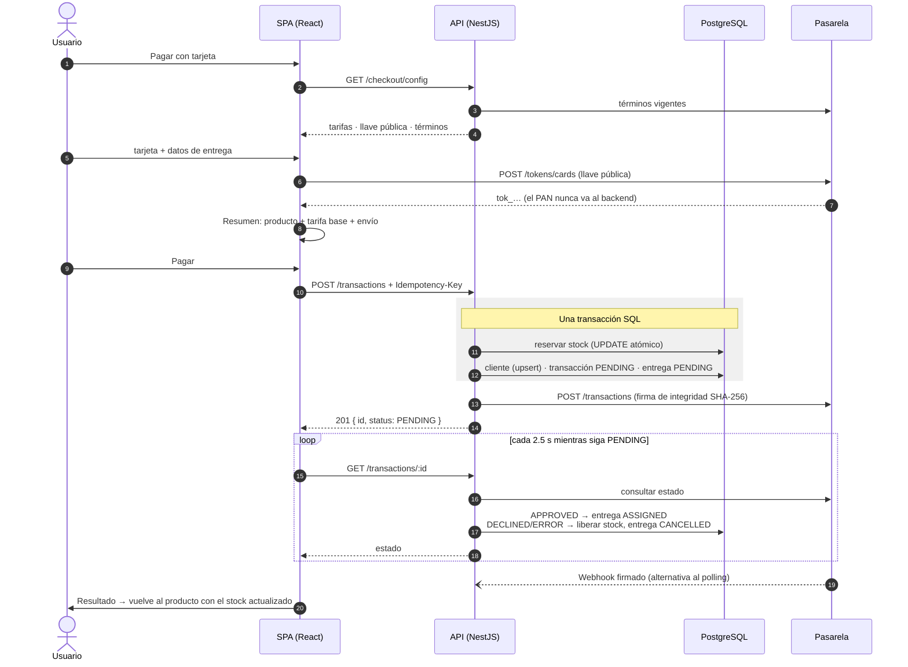

**Relación con el enunciado (paso 5):** 5.1 se crea en PENDING y se devuelve el número de transacción → 5.2 se cobra con la pasarela → 5.3 se actualiza el resultado, se asigna la entrega (`ASSIGNED`) y el stock queda descontado (si el pago falla, se devuelve al inventario).

---

## 🗄 Modelo de datos

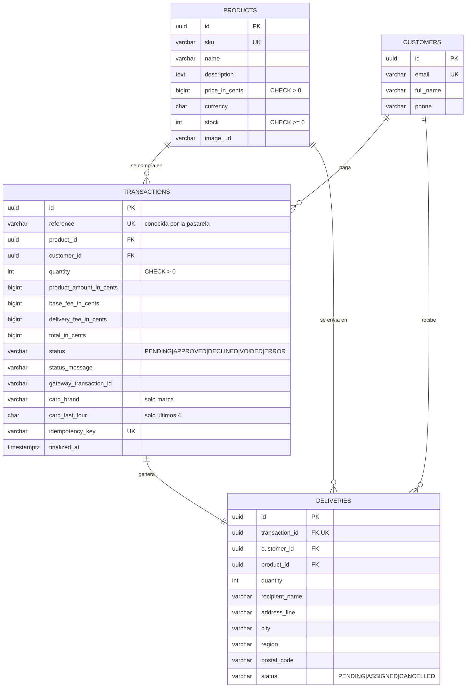

- **Montos en centavos** (`BIGINT`): nunca se usan decimales flotantes para dinero.
- Las reglas críticas también están en la base de datos (`CHECK`, `UNIQUE`, `FK`), así que ni un bug de la aplicación permite stock negativo o estados inventados.
- Migración explícita en SQL ([`InitialSchema`](backend/src/infrastructure/persistence/typeorm/migrations/1764000000000-InitialSchema.ts)), con `synchronize` desactivado.
- **Seed idempotente** con 4 productos: actualiza los datos descriptivos pero **no reinicia el stock** si se vuelve a ejecutar.

---

## 🔌 API

Base: `/api/v1` · Swagger UI: `/api/v1/docs` · OpenAPI: `/api/v1/docs/openapi.json`

| Recurso | Método | Ruta | Descripción | Respuestas |
|---------|--------|------|-------------|------------|
| **Stock** | `GET` | `/products` | Productos con unidades disponibles | 200 |
| | `GET` | `/products/:id` | Detalle y stock de un producto | 200 · 400 · 404 |
| **Checkout** | `GET` | `/checkout/config` | Tarifas, llave pública y términos | 200 · 502 |
| **Transacciones** | `POST` | `/transactions` | Crea la transacción (PENDING) y cobra. Header `Idempotency-Key` obligatorio | **201** · 200 (reintento) · 400 · 404 · 409 · 413 · 429 |
| | `GET` | `/transactions/:id` | Estado (sincroniza con la pasarela si sigue PENDING) | 200 · 400 · 404 |
| **Entregas** | `GET` | `/deliveries/:id` | Estado de la entrega | 200 · 400 · 404 |
| **Webhooks** | `POST` | `/webhooks/payment-events` | Eventos de la pasarela con firma verificada | 200 · 401 |
| **Salud** | `GET` | `/health` | API + base de datos | 200 · 503 |

Los **clientes** se crean o actualizan por email dentro de `POST /transactions` y se exponen enmascarados en la respuesta (`an*******@example.com`). Por privacidad, no hay un endpoint público que liste clientes.

**Formato único de error:**

```json
{ "statusCode": 409, "error": "INSUFFICIENT_STOCK", "message": "No hay unidades suficientes de este producto" }
```

| Error de dominio | HTTP |
|------------------|------|
| `PRODUCT_NOT_FOUND` · `TRANSACTION_NOT_FOUND` · `DELIVERY_NOT_FOUND` | 404 |
| `INSUFFICIENT_STOCK` · `IDEMPOTENCY_CONFLICT` | 409 |
| `INVALID_QUANTITY` | 422 |
| `INVALID_EVENT_SIGNATURE` | 401 |
| `PAYMENT_GATEWAY_ERROR` | 502 |
| Validación de DTO / JSON malformado / `INVALID_IDEMPOTENCY_KEY` | 400 |

<details>
<summary><b>Ejemplo: POST /transactions</b></summary>

```http
POST /api/v1/transactions
Idempotency-Key: 6f1c1f0e-8d1e-4f3b-9a51-0d6b9c2f7a10
Content-Type: application/json

{
  "productId": "…",
  "quantity": 1,
  "customer": { "email": "ana.gomez@example.com", "fullName": "Ana Gómez", "phone": "3001234567" },
  "shipping": { "addressLine": "Calle 10 # 43-12", "city": "Medellín", "region": "Antioquia", "postalCode": "050021" },
  "payment": { "cardToken": "tok_…", "installments": 1, "acceptanceToken": "…", "personalDataAuthToken": "…" }
}
```

```http
HTTP/1.1 201 Created
Location: /api/v1/transactions/0b6c…

{
  "id": "0b6c…", "reference": "CCA-MBX2K9Q1-4F9A1C2B7D3E5F60", "status": "PENDING",
  "quantity": 1, "product": { "id": "…", "name": "Aire Runner", "imageUrl": "…" },
  "amounts": { "productAmountInCents": 38990000, "baseFeeInCents": 300000,
               "deliveryFeeInCents": 1000000, "totalInCents": 40290000, "currency": "COP" },
  "payment": { "method": "CARD", "brand": "VISA", "lastFour": "4242" },
  "customer": { "email": "an*******@example.com" },
  "delivery": { "id": "…", "status": "PENDING", "city": "Medellín", "region": "Antioquia" }
}
```
</details>

**Postman:** importa la colección y ejecútala con el Runner. Cada petición guarda en variables lo que necesita la siguiente: configuración → tokenizar → crear → consultar. Incluye casos negativos (404, 400, 401). Se validó con `newman`: 12 peticiones y 13 aserciones en verde.

---

## 🔐 Seguridad

| Riesgo (OWASP) | Medida |
|----------------|--------|
| **Datos de tarjeta** (PCI-DSS) | Tokenización en el navegador. Solo se almacenan la marca y los últimos 4 dígitos. El `cardToken` se valida con `^tok_…`, así que un PAN enviado por error recibe 400 y nunca se procesa. |
| **A01 · Control de acceso** | IDs UUID v4 no adivinables. Las respuestas exponen el mínimo necesario: PII enmascarada, sin teléfono ni dirección completa. |
| **A02 · Criptografía** | HTTPS en todo el recorrido (HSTS con preload). RDS cifrado y con `rds.force_ssl`, con el certificado verificado mediante el bundle de CAs de RDS. Firma de integridad SHA-256 calculada en el servidor. Checksum del webhook comparado en tiempo constante (`timingSafeEqual`). |
| **A03 · Inyección** | DTOs estrictos (`whitelist` + `forbidNonWhitelisted`), regex por campo, consultas parametrizadas (TypeORM) y límite de 20 KB por petición. |
| **A04 · Diseño inseguro** | El monto lo calcula el servidor, la idempotencia es obligatoria, la reserva de stock es atómica y se verifica el monto y la referencia que confirma la pasarela. |
| **A05 · Configuración** | Helmet (CSP, HSTS, `X-Content-Type-Options`, `Referrer-Policy`), `Cache-Control: no-store`, `Permissions-Policy`, sin `X-Powered-By` y errores sin stack traces. La configuración se valida al arrancar (*fail fast*). |
| **A07 · Abuso / card testing** | Rate limiting en la app (120/min por IP; 10/min en `POST /transactions`) y throttling en API Gateway. |
| **A08 · Integridad** | Webhook con firma verificada antes de tocar la BD. Los eventos repetidos no tienen efecto (idempotencia). |
| **A09 · Logging** | Se registran rutas y estados, nunca cuerpos, tokens ni llaves. |
| **Secretos** | `.env` ignorado por git. En DigitalOcean son variables `SECRET` cifradas; en AWS viven en Secrets Manager y la Lambda solo recibe sus identificadores. |
| **Frontend** | CSP estricta en CloudFront (`script-src 'self'`, `connect-src 'self' <pasarela>`, `frame-ancestors 'none'`), enlaces con `rel="noopener noreferrer"`, `credentials: 'omit'` y nada sensible en `localStorage`. |

---

## 🔄 Resiliencia (refresh)

El progreso del checkout se guarda en `localStorage` (clave `trazo.checkout.v1`, **expira a los 30 min**) **sin datos sensibles**:

| Si recargas en… | Se recupera |
|-----------------|-------------|
| Formulario (paso 2) | Vuelve a abrirse con los datos de entrega diligenciados. |
| Resumen (paso 3) | Vuelve al formulario con la entrega intacta y un aviso: *"Por tu seguridad no guardamos los datos de la tarjeta"*. |
| Mientras se procesa (paso 4) | Retoma el polling en `/checkout/:id` y muestra el resultado. |
| Pago enviado sin respuesta | La `Idempotency-Key` se conserva: al reintentar, el backend devuelve la transacción original en lugar de cobrar otra vez. |

| ✔ Se persiste | ✘ Nunca se persiste |
|---------------|---------------------|
| paso, producto, cantidad, entrega, marca + últimos 4, Idempotency-Key, transacción | número de tarjeta, CVC, token de la pasarela, tokens legales |

<p align="center">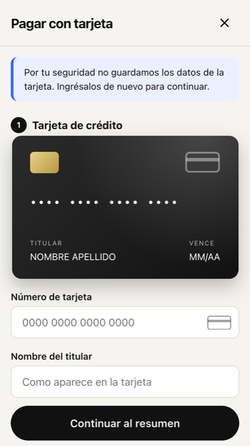</p>

---

## 🎨 Frontend y UX

- **React 19 + Redux Toolkit (Flux).** Las vistas despachan acciones, los reducers calculan el estado y el checkout es una máquina de estados explícita: `IDLE → DETAILS → SUMMARY → PROCESSING → RESULT`.
- **Mobile-first:** diseñado primero para iPhone SE (375 × 667) y validado ahí sin desbordes horizontales. Escala a tablet y escritorio con Grid y Flexbox.
- **Sin framework de CSS:** sistema de diseño propio con *design tokens*, CSS Modules, modo oscuro automático, `dvh`/`safe-area` para móviles, inputs de 16 px (evitan el zoom de iOS) y *hover* solo en dispositivos con puntero.
- **Imágenes rápidas y sin saltos:** ilustraciones SVG propias (< 2 KB cada una) con `width`/`height` explícitos (sin CLS), `loading="lazy"` fuera de pantalla y `fetchpriority="high"` en la imagen principal. Bundle: **14 KB gzip** de código propio y 92 KB de librerías en un chunk cacheable.
- **Accesibilidad:** diálogos con `aria-modal` y trampa de foco, cierre con Escape, errores con `aria-invalid`/`aria-describedby`, `aria-live` en estados, `autocomplete` de tarjeta y dirección, y soporte de `prefers-reduced-motion`.
- **Compatibilidad:** sin APIs experimentales. Con `crypto.randomUUID` hay respaldo y `localStorage` está protegido para el modo privado de Safari. Verificado en Chrome (móvil y escritorio).

<p align="center">
  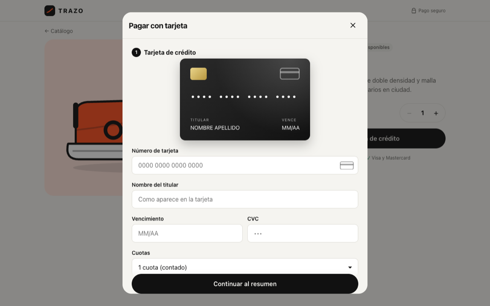
  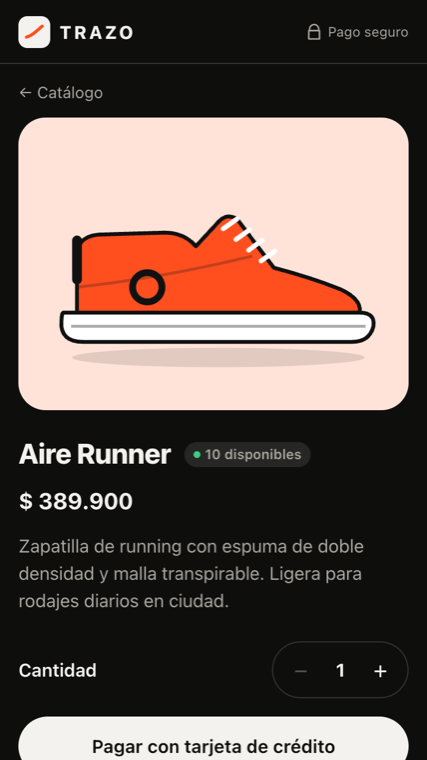
</p>

---

## 🧪 Tests y cobertura

Todos con **Jest**. El umbral mínimo (80 %) está configurado en cada proyecto y lo exige el CI.

| Proyecto | Tests | Sentencias | Ramas | Funciones | Líneas |
|----------|------:|-----------:|------:|----------:|-------:|
| **Backend** | 120 | **99.85 %** | **93.95 %** | **99.52 %** | **100 %** |
| **Frontend** | 92 | **99.86 %** | **93.20 %** | **100 %** | **100 %** |
| **Infra (CDK)** | 7 | aserciones sobre la plantilla CloudFormation | | | |

**Qué cubren:**

- **Dominio y ROP:** precios, estados, referencias y cada combinador de `Result`.
- **Casos de uso** con adaptadores en memoria: aprobado, rechazado, error de pasarela, rollback, idempotencia, condición de carrera entre webhook y polling, y anti-manipulación del monto.
- **Persistencia contra PostgreSQL real** (embebido, sin Docker): migraciones, `CHECK`/`UNIQUE` y **concurrencia** (10 compras sobre 5 unidades).
- **API e2e** con la app Nest real: cabeceras de seguridad, CORS, 413, 429, validaciones, códigos HTTP y Swagger.
- **Frontend:** validación de tarjetas (Luhn y rangos de Mastercard 2221–2720), slices, persistencia, todas las pantallas con Testing Library (polling con *fake timers*) y accesibilidad de diálogos.
- **Infra:** RDS privado y cifrado, S3 bloqueado, CSP, throttling y que no haya secretos en las variables de entorno.

```bash
cd backend  && npm run test:cov
cd frontend && npm run test:cov
cd infra    && npm test
```

Además, el **flujo completo** se ejecutó en Chrome *headless* a 375 px contra el sandbox real. Resultado: pago aprobado, stock de 11 a 10, cero errores de consola, ningún desborde y ningún dato sensible en `localStorage`.

---

## 💻 Ejecutar en local

**Requisitos:** Node.js 22. Docker es opcional.

```bash
# 1. Base de datos (elige una)
cd backend && npm ci
npm run db:start                    # PostgreSQL embebido, sin Docker (deja esta terminal abierta)
# o: docker compose up -d           # desde la raíz del repo

# 2. Backend (otra terminal)
cd backend
cp .env.example .env                # completa las llaves sandbox de la pasarela
npm run db:setup                    # build + migraciones + seed
npm run start:dev                   # http://localhost:3000/api/v1  ·  docs en /api/v1/docs

# 3. Frontend (otra terminal)
cd frontend && npm ci
npm run dev                         # http://localhost:5173  (proxy /api -> :3000)
```

---

## ☁ Despliegue

El mismo código corre en dos proveedores. Solo cambia la configuración, porque la nube es un adaptador más de la arquitectura hexagonal.

### Activo: DigitalOcean App Platform

Descrito como código en [`.do/app.yaml`](.do/app.yaml):
- sitio estático para el SPA;
- servicio NestJS;
- job `PRE_DEPLOY` con las migraciones y el seed;
- clúster PostgreSQL 16 administrado, con TLS verificado y firewall que solo admite la app.

El router envía `/api/*` al servicio, así que SPA y API comparten dominio.

```bash
doctl auth init                     # una vez, con un token de API
./scripts/deploy-digitalocean.sh    # llaves de backend/.env -> variables SECRET, sin tocar el repo
```

👉 Guía: **[docs/DEPLOY-DIGITALOCEAN.md](docs/DEPLOY-DIGITALOCEAN.md)** · Por qué dos proveedores: [ADR 006](docs/adr/006-digitalocean-app-platform.md)

### Alternativa lista: AWS (CDK)

Infraestructura como código con **AWS CDK**: VPC en 3 capas, RDS PostgreSQL, Lambda (arm64), API Gateway, S3 y CloudFront, más migraciones automáticas en cada despliegue. Todo entra en la capa gratuita.

```bash
./scripts/create-gateway-secret.sh                       # llaves -> Secrets Manager
(cd backend && npm run package:lambda) && (cd frontend && npm run build)
cd infra && npx cdk bootstrap && PAYMENT_GATEWAY_BASE_URL=https://… npx cdk deploy
```

👉 Guía paso a paso (desde crear la cuenta hasta destruir todo): **[docs/DEPLOY.md](docs/DEPLOY.md)**

---

## 🤖 Uso de IA

El proyecto se construyó con **Claude Code** como asistente en la terminal, siguiendo la recomendación de la prueba:

- **Diseño:** comparación React vs. Vue. Se eligió React porque Redux es el estándar actual de su ecosistema, mientras que Vuex está en modo mantenimiento.
- **Verificación contra la realidad:** antes de escribir código se probó el sandbox con `curl` (tokenizar → cobrar → consultar). Esa verificación detectó que los *acceptance tokens* son de un solo uso y que el cobro es asíncrono, y llevó a corregir un caché que habría hecho fallar al segundo cliente.
- **Revisión de seguridad durante el desarrollo:** se detectó y corrigió que un `createAsyncThunk` habría expuesto el número de tarjeta en Redux DevTools.
- **QA automatizado:** el flujo completo se ejecutó en un navegador real a 375 px, con capturas de cada paso, y la colección de Postman se validó con `newman`.

Cada decisión quedó documentada en los [ADRs](docs/adr/README.md) y el historial de commits sigue *Conventional Commits*, con ramas por funcionalidad.

---

<sub>Proyecto desarrollado como prueba técnica. TRAZO es una marca ficticia y las ilustraciones son originales.</sub>
